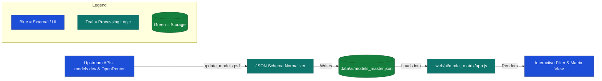
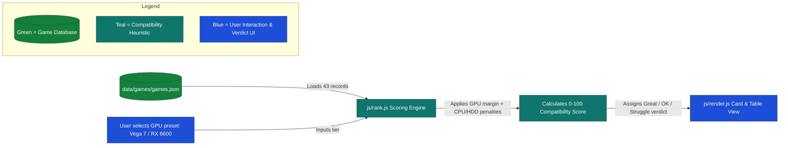
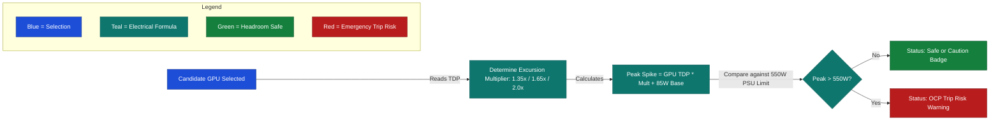
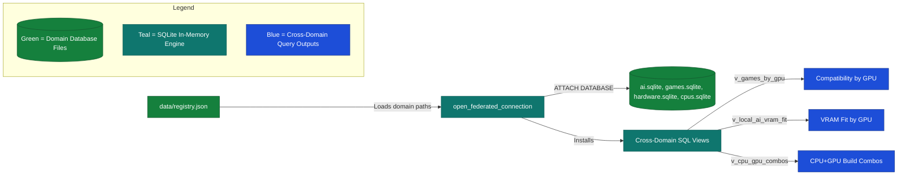
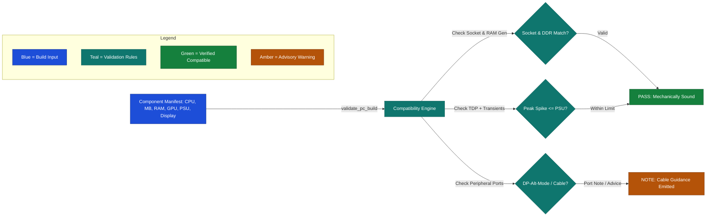
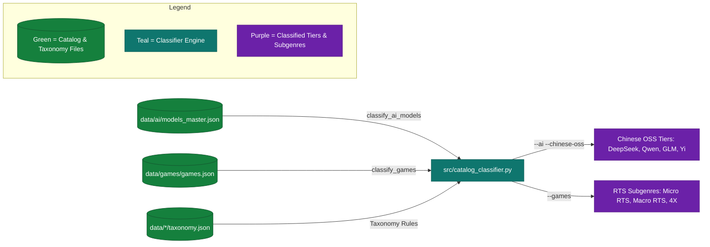
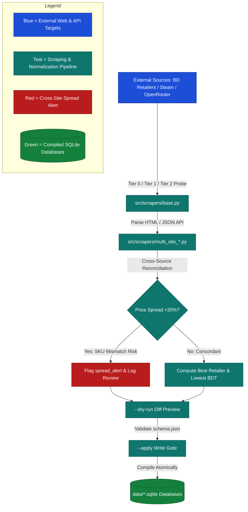
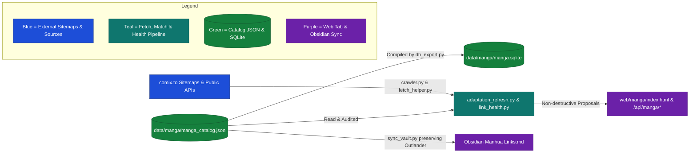

# System Architecture & Visual Flows (`ARCHITECTURE.md`)
> **1-Line Summary:** Single living visual map of how Database Manager operates, its tech stack rationale, Obsidian-compatible subsystem flowcharts, and extension recipes.

## 1. High-Level Visual System Map
* **Plain-English Overview:** Database Manager combines a zero-dependency Python backend with standalone client-side web dashboards and a relational SQLite database. Users can inspect benchmarks, simulate game frame rates, or evaluate GPU power draw via the Web Portal or the Terminal CLI.

```mermaid
flowchart TB
    %% Color Definitions (Obsidian & GitHub compatible)
    classDef startNode fill:#1d4ed8,stroke:#1e3a8a,color:#ffffff
    classDef processNode fill:#0f766e,stroke:#115e59,color:#ffffff
    classDef dataNode fill:#15803d,stroke:#14532d,color:#ffffff
    classDef outputNode fill:#6b21a8,stroke:#581c87,color:#ffffff

    User([User / Developer]):::startNode -->|Browser HTTP / Port 8770| Portal[Web Portal / Dashboard]:::outputNode
    User -->|Terminal Commands| CLI[CLI Search & Server Engine]:::processNode

    subgraph Backend["Python Standard Library Services (src/)"]
        CLI -->|Serves Web & REST API| Server[server.py HTTP Server]:::processNode
        Compiler[db_export.py Compiler]:::processNode -->|Compiles & Indexes| SQLite[(database.sqlite)]:::dataNode
        Hub[db_hub.py Multi-DB Hub]:::processNode -->|In-Memory ATTACH Federation| SQLite
        Scrapers[src/scrapers/ Engine]:::processNode -->|Multi-tier fetch & diff| DataHW
        Compat[src/compatibility_engine.py]:::processNode -->|Build Rule Checks| Server
        Classifiers[src/catalog_classifier.py]:::processNode -->|Multi-axis taxonomies| Server
    end

    subgraph DataLayer["Multi-Domain Datasets (data/)"]
        DataAI[(data/ai/ — Models & Taxonomy)]:::dataNode
        DataGames[(data/games/ — Games & Benchmarks)]:::dataNode
        DataHW[(data/hardware/ — GPU & PSU Specs)]:::dataNode
        DataCPUs[(data/cpus/ — Desktop CPUs)]:::dataNode
        DataComp[(data/pc_components/ — Components)]:::dataNode
        DataManga[(data/manga/ — Manga & Adaptations)]:::dataNode
        Registry[data/registry.json — Domain Hub]:::dataNode
    end

    subgraph WebDashboards["Client-Side Visualizers (web/)"]
        Portal -->|Tab 1| AIView[AI Model Matrix]:::outputNode
        Portal -->|Tab 2| GameView[GameRank FPS Simulator]:::outputNode
        Portal -->|Tab 3| HWView[PSU Transient Guard]:::outputNode
        Portal -->|Tab 4| MangaView[Manga & Adaptations]:::outputNode
    end

    DataAI -->|Loaded by| Server
    DataGames -->|Loaded by| Server
    DataHW -->|Loaded by| Server
    DataCPUs -->|Loaded by| Server
    DataComp -->|Loaded by| Server
    DataManga -->|Loaded by| Server

    DataAI -->|Ingested by| Compiler
    DataGames -->|Ingested by| Compiler
    DataHW -->|Ingested by| Compiler
    DataCPUs -->|Ingested by| Compiler
    DataComp -->|Ingested by| Compiler
    DataManga -->|Ingested by| Compiler

    Server -->|JSON REST Endpoints| Portal

    subgraph Legend["Legend (Color Guide)"]
        L1([Blue = User Entrypoint]):::startNode
        L2[Teal = Python Processing & Server Engine]:::processNode
        L3[(Green = Master Datasets & SQLite Storage)]:::dataNode
        L4[Purple = Interactive Web Dashboards]:::outputNode
    end
```

## 2. Tech Stack & Why We Chose It

| Layer | Tool / Library | Plain-English Reason Why |
| :--- | :--- | :--- |
| **Backend & CLI** | Python 3.10+ (Standard Library) | `http.server`, `sqlite3`, and `json` require zero `pip install` steps, avoiding virtual environment bloat on the local PC. |
| **Relational Storage** | SQLite 3 | Embedded single-file database (`data/database.sqlite`) offering instant local querying and portability across machines. |
| **Web Interface** | Vanilla HTML5 / Modern CSS / ES6 | Fast, zero-build dashboards with glassmorphic UI, responsive tables, and zero runtime overhead. |
| **Visual Charts** | Chart.js (CDN / Bundled) | Lightweight canvas-based charting for Pareto frontier curves and transient power excursion meters. |
| **Verification & CI** | PowerShell + GitHub Actions | Dual verification paths: fast local sanity checks via `local-ci.ps1` and authoritative cloud runs via `ci.yml`. |

## 3. Core Subsystems & Visual Feature Flows

### [SUBSYSTEM: AI-Model-Matrix-Pipeline] | Aliases: ai pipeline, models dev, openrouter sync
> **1-Line Summary:** Data ingestion and normalized scoring flow for 26+ frontier AI models.

### [SUBSYSTEM: GameRank-Compatibility-Engine] | Aliases: vega 7 simulator, game benchmark flow
> **1-Line Summary:** Heuristic scoring engine evaluating 43 RTS games against Ryzen 5 5600GT hardware parameters and simulated GPU upgrades.

### [SUBSYSTEM: PSU-Transient-Guard-Engine] | Aliases: psu excursion, spike calculator, ocp checker
> **1-Line Summary:** Physics-based electrical load and transient power spike calculator safeguarding 550W single-rail power supplies.

### [SUBSYSTEM: Multi-Tier-Scraper-And-BD-Retail-Sync] | Aliases: scraper stack, bd retail sync, star tech scraper
> **1-Line Summary:** Multi-tier fallback architecture (Tier 1 httpx/selectolax -> Tier 0 urllib/regex) scraping retail pricing with non-destructive diff previews.

* **Plain-English Overview:** Fetches live product listings from local retailers (Star Tech, Ryans, UCC) for candidate GPUs, extracts prices with CSS selectors or regex, and computes changes against the catalog before writing.

### [SUBSYSTEM: Cross-Domain-Federated-Hub] | Aliases: db hub, in memory attach, cross domain views
> **1-Line Summary:** In-memory SQLite ATTACH federation combining domain databases into cross-domain analytical views.

* **Plain-English Overview:** Opens an in-memory SQLite connection, dynamically attaches all registered domain databases (`ai`, `games`, `hardware`, `cpus`), and creates cross-domain views (`v_games_by_gpu`, `v_local_ai_vram_fit`, `v_cpu_gpu_combos`) without duplicating tables.

### [SUBSYSTEM: Full-Rig-Compatibility-Validator] | Aliases: compatibility validator, pc build checker, peripheral guard
> **1-Line Summary:** Rule-based validation engine checking physical socket, RAM generation, PCIe bandwidth, PSU headroom, and peripheral cable constraints.

* **Plain-English Overview:** Validates complete PC component selections against physical, electrical, and bus constraints, warning about CPU-motherboard socket mismatches, DDR generation incompatibilities, drawing tablet display connections, and SMR storage lag.

### [SUBSYSTEM: Multi-Axis-Catalog-Taxonomy-Engine] | Aliases: catalog taxonomy, llm classifier, rts taxonomy
> **1-Line Summary:** Multi-axis taxonomy classifier categorizing AI models by geopolitical origin/capability and games by tactical pacing.

* **Plain-English Overview:** Analyzes catalog entries against structured taxonomies (`data/ai/taxonomy.json`, `data/games/taxonomy.json`) to tag AI models into Chinese OSS vs Western Frontier tiers and classify strategy titles into micro, macro, and 4X subgenres.

### [SUBSYSTEM: Multi-Site-Scraping-Pipeline] | Aliases: multi site scrapers, retail reconciliation, fallback tiers
> **1-Line Summary:** Multi-tier scraper architecture reconciling live pricing, hardware specifications, and LLM telemetry across 3+ independent sources per domain.

* **Plain-English Overview:** Fetches live pricing and specs across Star Tech, Ryans, UCC BD, Steam Store API, PCGamingWiki, OpenRouter API, and Models.dev. Automatically falls back from Tier 0 (stdlib) to Tier 1 (httpx + selectolax lexbor) and Tier 2 (Scrapling stealth). Computes price spread deltas and prompts confirmation before persisting via `--apply`.

### [SUBSYSTEM: Manga-Catalog-And-Adaptation-Pipeline] | Aliases: manga pipeline, comix sitemaps, link health, obsidian manhua sync
> **1-Line Summary:** Sitemap indexing, Chrome-impersonated adaptation probing, link-health verification, SQLite compilation, and non-destructive Obsidian vault synchronization for 104+ comic titles.

* **Plain-English Overview:** `src/manga/crawler.py` caches `comix.to` sitemaps locally (gitignored), `indexer.py` + `matcher.py` propose canonical series URLs, `adaptation_refresh.py` + `link_health.py` audit adaptations and URL health via `fetch_helper.py` (`curl_cffi` with `urllib` fallback), and `sync_vault.py` updates `Manhua Links.md` while keeping everything beneath `### Outlander` intact.

## 4. Extension Recipes: Adding New Datasets

1. **Adding a New AI Model:**
   * Append model object to `data/ai/models_master.json` following the `scores` and `pricing` schema.
   * Run `python src/db_export.py` to refresh `data/database.sqlite`.

2. **Adding a New PC Game:**
   * Append game record to `data/games/games.json` (and mirror in `web/games/data/games.js`), then run `python src/db_export.py` to atomically rebuild `data/database.sqlite`.

3. **Adding a New GPU / Hardware Component:**
   * Add GPU entry to `data/hardware/hardware_specs.json` with TDP, tier, and local market prices.
   * Run `python src/db_export.py` to regenerate the relational table.

4. **Adding a New Domain Database (e.g. SSDs, Laptops, Monitors):**
   * Run `python src/db_export.py --init-domain <domain_name>` to scaffold `data/<domain_name>/`.
   * Define field rules in `data/<domain_name>/schema.json` and records in `data/<domain_name>/<domain_name>.json`.
   * Add export compiler function in `src/db_export.py` and run `python src/db_export.py` to compile `<domain_name>.sqlite`.
   * Run `python src/db_verify.py` to confirm zero errors and zero warnings across all domains.
