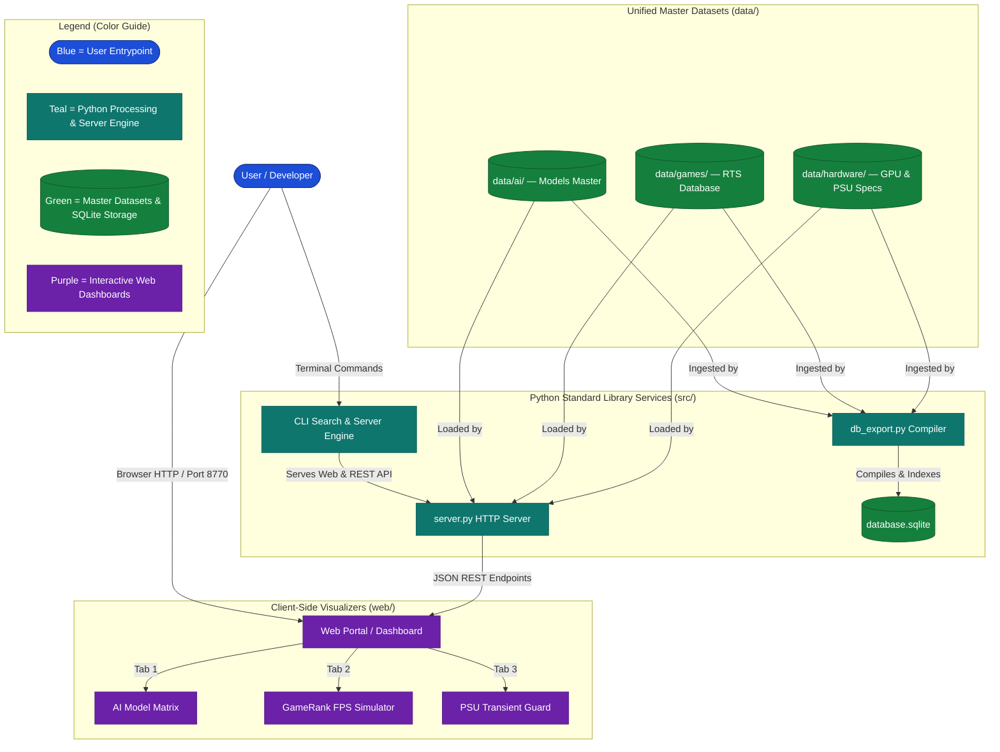
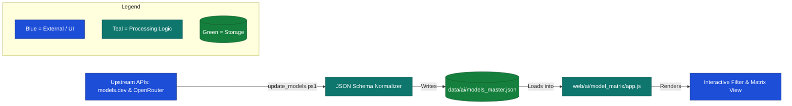
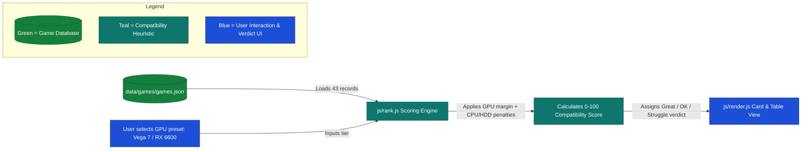
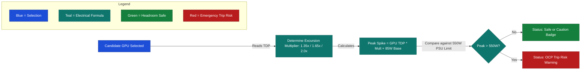

# System Architecture & Visual Flows (`ARCHITECTURE.md`)
> **1-Line Summary:** Single living visual map of how Database Manager operates, its tech stack rationale, Obsidian-compatible subsystem flowcharts, and extension recipes.

## 1. High-Level Visual System Map
* **Plain-English Overview:** Database Manager combines a zero-dependency Python backend with standalone client-side web dashboards and a relational SQLite database. Users can inspect benchmarks, simulate game frame rates, or evaluate GPU power draw via the Web Portal or the Terminal CLI.

## 2. Tech Stack & Why We Chose It

| Layer | Tool / Library | Plain-English Reason Why |
| :--- | :--- | :--- |
| **Backend & CLI** | Python 3.10+ (Standard Library) | `http.server`, `sqlite3`, and `json` require zero `pip install` steps, avoiding virtual environment bloat on the local PC. |
| **Relational Storage** | SQLite 3 | Embedded single-file database (`data/database.sqlite`) offering instant local querying and portability across machines. |
| **Web Interface** | Vanilla HTML5 / Modern CSS / ES6 | Fast, zero-build dashboards with glassmorphic UI, responsive tables, and zero runtime overhead. |
| **Visual Charts** | Chart.js (CDN / Bundled) | Lightweight canvas-based charting for Pareto frontier curves and transient power excursion meters. |
| **Verification & CI** | PowerShell + GitHub Actions | Dual verification paths: fast local sanity checks via `local-ci.ps1` and authoritative cloud runs via `ci.yml`. |

## 3. Core Subsystems & Visual Feature Flows

### [SUBSYSTEM: AI-Model-Matrix-Pipeline] | Aliases: ai pipeline, models dev, openrouter sync
> **1-Line Summary:** Data ingestion and normalized scoring flow for 26+ frontier AI models.

### [SUBSYSTEM: GameRank-Compatibility-Engine] | Aliases: vega 7 simulator, game benchmark flow
> **1-Line Summary:** Heuristic scoring engine evaluating 43 RTS games against Ryzen 5 5600GT hardware parameters and simulated GPU upgrades.

### [SUBSYSTEM: PSU-Transient-Guard-Engine] | Aliases: psu excursion, spike calculator, ocp checker
> **1-Line Summary:** Physics-based electrical load and transient power spike calculator safeguarding 550W single-rail power supplies.

## 4. Extension Recipes: Adding New Datasets

1. **Adding a New AI Model:**
   * Append model object to `data/ai/models_master.json` following the `scores` and `pricing` schema.
   * Run `python src/db_export.py` to refresh `data/database.sqlite`.

2. **Adding a New PC Game:**
   * Append game record to `data/games/games.json` (and mirror in `web/games/data/games.js`), then run `python src/db_export.py` to atomically rebuild `data/database.sqlite`.

3. **Adding a New GPU / Hardware Component:**
   * Add GPU entry to `data/hardware/hardware_specs.json` with TDP, tier, and local market prices.
   * Run `python src/db_export.py` to regenerate the relational table.
