# System Architecture & Visual Flows (`ARCHITECTURE.md`)
> **1-Line Summary:** Single living visual map of how Database Manager operates, its tech stack rationale, Obsidian-compatible subsystem flowcharts, and extension recipes.

## 1. High-Level Visual System Map
* **Plain-English Overview:** Database Manager combines a zero-dependency Python backend with registry-driven, grouped web dashboards and isolated per-domain SQLite databases federated via `ATTACH DATABASE`. PC hardware is unified under `pc` (`79` parts across `12` categories) and deeply cross-linked with `games` (`153` unified owned Steam & wishlist titles across `12` genres), while `ai` remains strictly pricing/benchmark-focused (no local VRAM coupling), and `media`, `book`, `phone`, and `github` run cleanly in isolated tables.

```mermaid
flowchart TB
    %% Color Definitions (Obsidian & GitHub compatible)
    classDef startNode fill:#1d4ed8,stroke:#1e3a8a,color:#ffffff
    classDef processNode fill:#0f766e,stroke:#115e59,color:#ffffff
    classDef dataNode fill:#15803d,stroke:#14532d,color:#ffffff
    classDef outputNode fill:#6b21a8,stroke:#581c87,color:#ffffff

    User([User / Developer]):::startNode -->|HTTP / Port 8770| Portal[Dynamic Grouped Portal]:::outputNode
    User -->|Terminal Commands| CLI[CLI Search & Verify Tools]:::processNode

    subgraph Backend["Python Standard Library Services (src/)"]
        CLI -->|Serves Web & REST API| Server[server.py HTTP Server]:::processNode
        Compiler[db_export.py Compiler]:::processNode -->|Consolidated + Table-Isolated DBs| SQLite[(database.sqlite & data/*/*.sqlite)]:::dataNode
        Hub[db_hub.py Federated Hub]:::processNode -->|In-Memory ATTACH: games x pc| SQLite
        Scrapers[src/scrapers/ Engine]:::processNode -->|Multi-tier fetch & diff| DataPC
        Compat[src/compatibility_engine.py]:::processNode -->|Build & PSU Rules| Server
        Classifiers[src/catalog_classifier.py]:::processNode -->|AI, Games, Media, GitHub Taxonomies| Server
        MediaEngine[src/media/ Engine]:::processNode -->|Sitemaps, Doctor & Link Audit| DataMedia
        GitHubEngine[src/github/ Engine]:::processNode -->|gh api scan & triage| DataGitHub
    end

    subgraph DataLayer["7 Registered Grouped Datasets (data/)"]
        Registry[data/registry.json — Groups, Display Names & Aliases]:::dataNode
        DataPC[(data/pc/ — Unified CPUs, GPUs, PSUs & Peripherals)]:::dataNode
        DataGames[(data/games/ — RTS Games & benchmarks.csv)]:::dataNode
        DataAI[(data/ai/ — API Pricing, Intelligence & Tiers)]:::dataNode
        DataMedia[(data/media/ — Comics, Novels, Anime, Movies & Series)]:::dataNode
        DataBook[(data/book/ — Books & Reading Tracker)]:::dataNode
        DataPhone[(data/phone/ — Phone Specs, Supported Games & Apps)]:::dataNode
        DataGitHub[(data/github/ — Public Repos & Gitignored Cache)]:::dataNode
    end

    subgraph WebDashboards["Grouped Safe-DOM Web Views (web/)"]
        Portal -->|Group: PC & Gaming| PCView[PC & PSU Guard]:::outputNode
        Portal -->|Group: PC & Gaming| GameView[GameRank + PC GPU Link]:::outputNode
        Portal -->|Group: AI Models| AIView[AI Pricing & Matrix]:::outputNode
        Portal -->|Group: Media & Books| MediaView[Media & Adaptations]:::outputNode
        Portal -->|Group: Media & Books| BookView[Book Collection]:::outputNode
        Portal -->|Group: Mobile| PhoneView[Phone & Apps Matrix]:::outputNode
        Portal -->|Group: DevOps| GitHubView[GitHub Repos & CI]:::outputNode
    end

    Registry -->|Drives tabs, aliases & stats| Server
    DataPC <-->|GPU tiers & FPS benchmarks| DataGames
    DataPC --> Server
    DataGames --> Server
    DataAI --> Server
    DataMedia --> Server
    DataBook --> Server
    DataPhone --> Server
    DataGitHub --> Server

    DataPC --> Compiler
    DataGames --> Compiler
    DataAI --> Compiler
    DataMedia --> Compiler
    DataBook --> Compiler
    DataPhone --> Compiler
    DataGitHub --> Compiler

    Server -->|JSON REST Endpoints| Portal

    subgraph Legend["Legend (Color Guide)"]
        L1([Blue = User Entrypoint]):::startNode
        L2[Teal = Python Processing & Server Engine]:::processNode
        L3[(Green = Registry, Datasets & SQLite Storage)]:::dataNode
        L4[Purple = Registry-Driven Web Dashboards]:::outputNode
    end
```

## 2. Tech Stack & Why We Chose It

| Layer | Tool / Library | Plain-English Reason Why |
| :--- | :--- | :--- |
| **Backend & CLI** | Python 3.10+ (Standard Library) | `http.server`, `sqlite3`, `csv`, and `json` require zero `pip install` steps, avoiding virtual environment bloat on the local PC. |
| **Relational Storage** | SQLite 3 (Isolated + Consolidated) | Each domain compiles to its own table-isolated `data/<domain>/<domain>.sqlite` plus consolidated `data/database.sqlite`, joined cross-domain in memory via `ATTACH DATABASE`. |
| **Web Interface** | Vanilla HTML5 / Modern CSS / ES6 | Zero-build safe-DOM (`createElement` / `textContent`) dashboards dynamically structured from `data/registry.json` groups, `display_name`, and `aliases`. |
| **Visual Charts** | Chart.js (CDN / Bundled) | Lightweight canvas-based charting for Pareto frontier curves and transient power excursion meters. |
| **Verification & CI** | PowerShell + GitHub Actions | Dual verification paths: fast local sanity checks via `local-ci.ps1` and authoritative cloud runs via `ci.yml`. |

## 3. Core Subsystems & Visual Feature Flows

### [SUBSYSTEM: AI-Model-Matrix-Pipeline] | Aliases: ai pipeline, models dev, openrouter sync
> **1-Line Summary:** Data ingestion and normalized scoring flow for 26+ frontier AI models.

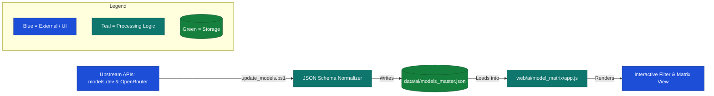

### [SUBSYSTEM: GameRank-Compatibility-Engine] | Aliases: vega 7 simulator, game benchmark flow
> **1-Line Summary:** Heuristic scoring, Steam enrichment, 8-GPU progressive benchmark table (`benchmarks.csv`), and storage footprint engine evaluating 195 owned/wishlist PC & RTS games against Ryzen 5 5600GT hardware and simulated GPU/SSD upgrades.

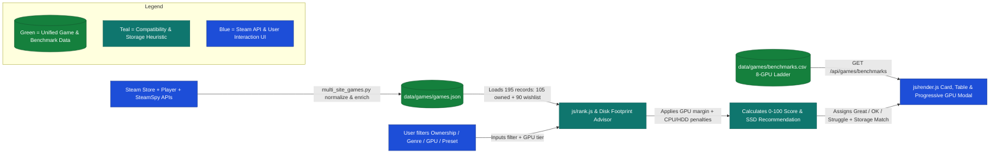

### [SUBSYSTEM: PSU-Transient-Guard-Engine] | Aliases: psu excursion, spike calculator, ocp checker
> **1-Line Summary:** Physics-based electrical load and transient power spike calculator safeguarding 550W single-rail power supplies.

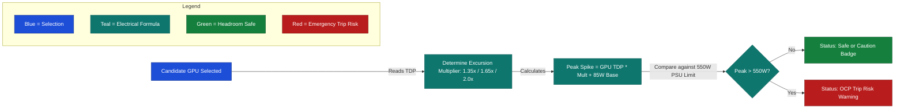

### [SUBSYSTEM: Multi-Tier-Scraper-And-BD-Retail-Sync] | Aliases: scraper stack, bd retail sync, star tech scraper
> **1-Line Summary:** Multi-tier fallback architecture (Tier 1 httpx/selectolax -> Tier 0 urllib/regex) scraping retail pricing with non-destructive diff previews.

* **Plain-English Overview:** Fetches live product listings from local retailers (Star Tech, Ryans, UCC) for candidate GPUs, extracts prices with CSS selectors or regex, and computes changes against the catalog before writing.

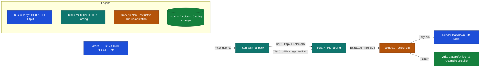

### [SUBSYSTEM: Cross-Domain-Federated-Hub] | Aliases: db hub, in memory attach, cross domain views
> **1-Line Summary:** In-memory SQLite ATTACH federation joining isolated `pc.sqlite` and `games.sqlite` databases into `games` <-> `pc` views while keeping `ai` separate.

* **Plain-English Overview:** Opens an in-memory SQLite connection, dynamically attaches all compiled domain databases (`pc`, `games`, `ai`, `media`, `book`, `phone`, `github`), resolves aliases via `resolve_domain_key`, and creates strictly `games` <-> `pc` cross-domain views (`v_games_by_gpu`, `v_game_benchmarks_with_pc`, `v_cpu_gpu_combos`) without duplicating tables or coupling cloud AI models to local GPU VRAM.

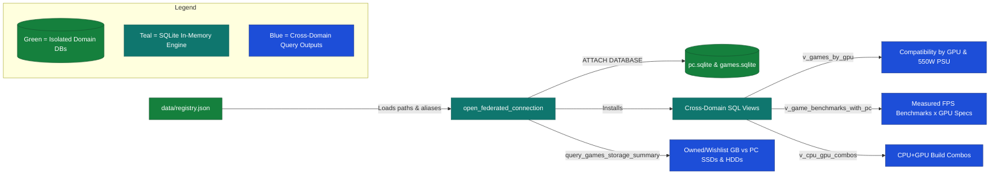

### [SUBSYSTEM: Full-Rig-Compatibility-Validator] | Aliases: compatibility validator, pc build checker, peripheral guard
> **1-Line Summary:** Rule-based validation engine checking physical socket, RAM generation, PCIe bandwidth, PSU headroom, and peripheral cable constraints.

* **Plain-English Overview:** Validates complete PC component selections against physical, electrical, and bus constraints, warning about CPU-motherboard socket mismatches, DDR generation incompatibilities, drawing tablet display connections, and SMR storage lag.

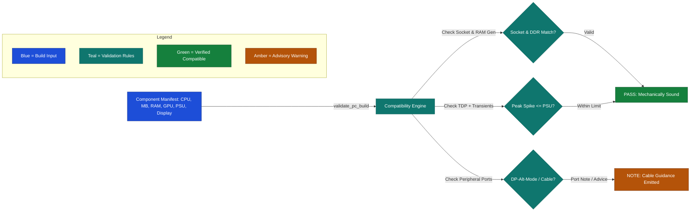

### [SUBSYSTEM: Multi-Axis-Catalog-Taxonomy-Engine] | Aliases: catalog taxonomy, llm classifier, rts taxonomy
> **1-Line Summary:** Multi-axis taxonomy classifier categorizing AI models by geopolitical origin/capability and games by tactical pacing.

* **Plain-English Overview:** Analyzes catalog entries against structured taxonomies (`data/ai/taxonomy.json`, `data/games/taxonomy.json`) to tag AI models into Chinese OSS vs Western Frontier tiers and classify strategy titles into micro, macro, and 4X subgenres.

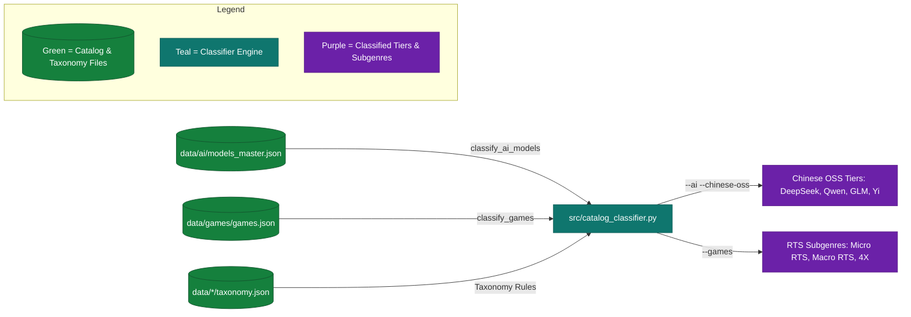

### [SUBSYSTEM: Multi-Site-Scraping-Pipeline] | Aliases: multi site scrapers, retail reconciliation, fallback tiers
> **1-Line Summary:** Multi-tier scraper architecture reconciling live pricing, hardware specifications, and LLM telemetry across 3+ independent sources per domain.

* **Plain-English Overview:** Fetches live pricing and specs across Star Tech, Ryans, UCC BD, Steam Store API, PCGamingWiki, OpenRouter API, and Models.dev. Automatically falls back from Tier 0 (stdlib) to Tier 1 (httpx + selectolax lexbor) and Tier 2 (Scrapling stealth). Computes price spread deltas and prompts confirmation before persisting via `--apply`.

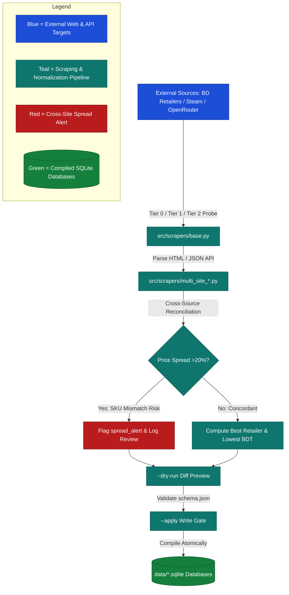

### [SUBSYSTEM: Media-Catalog-And-Adaptation-Pipeline] | Aliases: media pipeline, manga, manhua, light_novel, anime, donghua, movie, tv_series, comix sitemaps
> **1-Line Summary:** Sitemap indexing, Chrome-impersonated adaptation probing, link-health verification, and interconnected franchise graph compilation (`media.sqlite`) without external Obsidian markdown sync.

* **Plain-English Overview:** `src/media/crawler.py` caches `comix.to` sitemaps locally (gitignored), `indexer.py` + `matcher.py` propose canonical series URLs, and `adaptation_refresh.py` + `link_health.py` audit adaptations and URL health via `fetch_helper.py` (`curl_cffi` with `urllib` fallback). Interconnected subdomains (`comic`, `light_novel`, `anime`, `donghua`, `movie`, `tv_series`) share `franchise_id` and `relations` links inside `data/media/media_catalog.json` (including public `Outlander` TV series tracking without private MEGA URLs), replacing the retired Obsidian markdown sync.

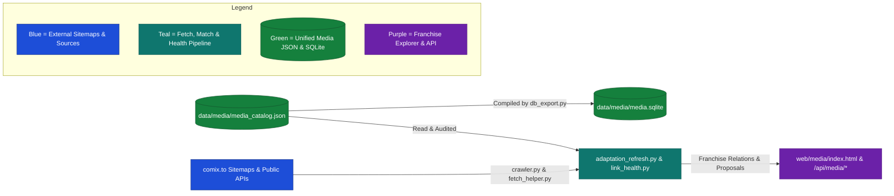

### [SUBSYSTEM: Book-And-Phone-Catalog-Domains] | Aliases: book domain, phone domain, learning alias, mobile games matrix
> **1-Line Summary:** Table-isolated storage, schema contracts, REST APIs, and safe-DOM UIs for personal book tracking (`book`) and smartphone specs/supported apps (`phone`).

* **Plain-English Overview:** `db_export.py` compiles `data/book/books.json` into isolated `data/book/book.sqlite` (`books` + `_meta`) and `data/phone/phones.json` into `data/phone/phone.sqlite` (`phones` + `_meta`). Both domains support alias lookup via `/api/domain/<alias>` (e.g. `learning` -> `book`) and render via safe-DOM dashboards in `web/book/index.html` and `web/phone/index.html`.

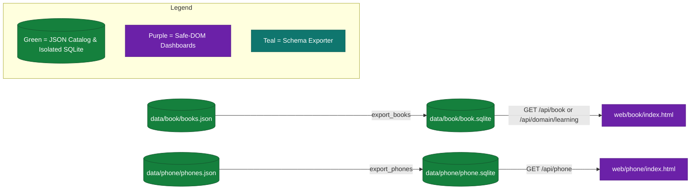

### [SUBSYSTEM: GitHub-Repo-Triage-And-CI-Hub] | Aliases: github manager, repo triage, ci health, fork drift, local sync, cliproxyapi
> **1-Line Summary:** Async `gh api` scanner with live progress/cancel/single-repo refresh, local-vs-web git drift reconciliation (`local_sync.py`), backend CLIProxyAPI (`127.0.0.1:8317/v1`) AI assistant (`agent_proxy.py`), privacy redaction, safe DOM DevOps UI, and SQLite export.

* **Plain-English Overview:** `src/github/scanner.py` runs async or blocking `gh api` scans with 15-second timeouts, real-time per-repo progress polling (`/api/github/refresh/status`), cancellation, and single-repo quick refresh. `src/github/local_sync.py` scans local Git roots (`GIT_TERMINAL_PROMPT=0`) to flag local-only, web-only, dirty, ahead/behind, and newly deleted repos, persisting private/local telemetry strictly in gitignored `data/github/live_cache.json` and `sync_state.json`. `src/agent_proxy.py` connects securely on loopback to CLIProxyAPI (`ecosystem-registry.json -> 127.0.0.1:8317/v1`) and authenticated Google/Antigravity accounts (`~/.cli-proxy-api/`) to generate AI executive reports and cross-domain Q&A, while `web/shared/nav.js` and `web/index.html` (`#home` Overview Hub) provide one-click navigation across all 7 domains.

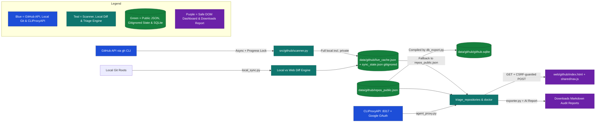

## 4. Extension Recipes: Adding or Renaming Datasets

1. **Adding a New AI Model:**
   * Append model object to `data/ai/models_master.json` following the `scores`, `pricing`, and `classification` schema.
   * Run `python src/db_export.py` to refresh `data/database.sqlite` and `data/ai/ai.sqlite`.

2. **Adding a New PC Game or Benchmark Run:**
   * Append game record to `data/games/games.json` (and mirror in `web/games/data/games.js` & `data/games/games.js`), and always populate `data/games/benchmarks.csv` for all 8 canonical GPUs in `data/games/taxonomy.json -> benchmark_gpu_ladder` (`vega-7-igpu`, `rx-580-8gb`, `gtx-1660-super`, `rtx-2060-super`, `rx-6600`, `rtx-2070`, `rtx-3060`, `rtx-2070-super`) paired with `AMD Ryzen 5 5600GT`.
   * Run `python src/db_export.py` to rebuild `games.sqlite` and `v_game_benchmarks_with_pc`.

3. **Adding a New PC Part / GPU / CPU / PSU:**
   * Add entry into the appropriate category array inside `data/pc/pc.json` and run `python src/db_export.py` + `python src/db_verify.py --domain pc`.

4. **Renaming a Domain Display Label or Adding Aliases (`Book` -> `Learning`):**
   * Edit `display_name`, `short_label`, `unit_label`, `aliases`, or `group` in `data/registry.json` — the dynamic web portal (`web/index.html`), `/api/domains`, `/api/status`, `/api/domain/<alias>`, and `db_verify.py` pick up the new label with zero source-code edits.

5. **Adding a New Domain Database (e.g. SSDs, Laptops, Courses):**
   * Run `python src/db_export.py --init-domain <domain_name>` to scaffold `data/<domain_name>/`.
   * Define field rules in `data/<domain_name>/schema.json` (using `[min, max]` arrays for `ranges`) and records in `data/<domain_name>/<domain_name>.json`.
   * Register an isolated schema creator and exporter in `src/db_export.py` (`SCHEMA_CREATORS`) and run `python src/db_export.py` + `python src/db_verify.py`.
