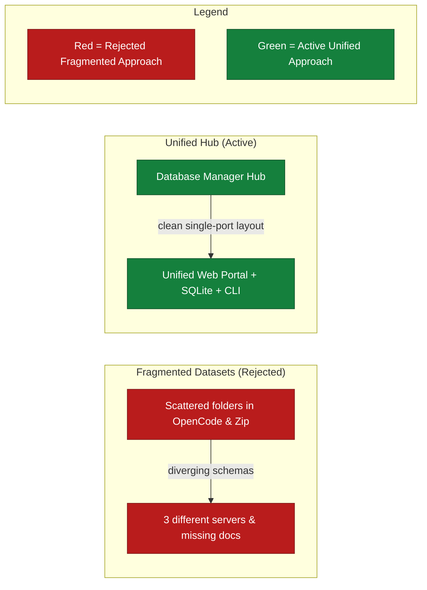
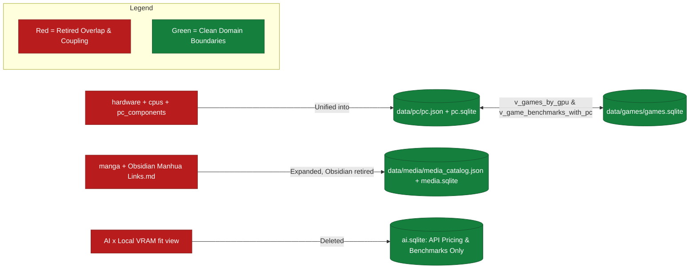

# Architectural Decisions, Pivots & Landmines (`DECISIONS_AND_TRAPS.md`)
> **1-Line Summary:** Records why we chose specific approaches, what failed when we tried other ways, who made the decision, and full explanations of critical code traps.

## 1. Architectural Decisions & Pivot History

### [DECISION: Unified-Multi-Domain-Manager] | Aliases: multi domain hub, repo merge, database manager
> **1-Line Summary:** Consolidated AI models, PC game compatibility, and hardware upgrade planning into a single `Database Manager` repository.
* **Decision Maker:** `[DECIDED BY: HUMAN]`
* **Original User Intention:** Eliminate fragmented datasets across `OpenCode\AI Rank`, `OpenCode\GameRank`, and `hardware-planner.zip` by uniting them under the Agentic Harness standard.
* **Options Considered:**
  * **Option A (Rejected):** Maintain 3 separate disconnected repositories, duplicating web servers, local CI scripts, and documentation suites.
  * **Option B (Chosen):** Create a unified `Database Manager` with modular domains (`data/ai/`, `data/games/`, `data/hardware/`), a unified tabbed Web Portal, and consolidated SQLite compilation.
* **Plain-English Summary of Pivot:** Maintaining 3 independent repos caused drift, duplicate servers, and inconsistent documentation. The unified hub provides one port (`8770`), one CLI, and one relational SQLite database.



### [DECISION: Zero-Dependency-Python-Backend] | Aliases: stdlib server, no pip, lightweight cli
> **1-Line Summary:** Built server and CLI using Python Standard Library (`http.server`, `sqlite3`, `json`) with zero pip dependencies.
* **Decision Maker:** `[DECIDED BY: AGENT - Approved by Human]`
* **Original User Intention:** Ensure the local server and CLI run instantly on any machine without installing heavy virtual environments or pip packages.
* **Options Considered:**
  * **Option A (Rejected):** Use FastAPI / Uvicorn or Express.js, requiring virtual environments, node_modules, and background dependency maintenance.
  * **Option B (Chosen):** Use built-in `http.server`, `socketserver`, and `sqlite3` from Python's standard library.
* **Plain-English Summary of Pivot:** Standard library execution starts in under 50ms, requires zero package installations, and eliminates environment breakages across updates.

### [DECISION: Multi-Tier-Scraper-Stack] | Aliases: scraper tiers, scrapling, httpx fallback, selectolax lexbor
> **1-Line Summary:** Tiered scraper framework (Tier 0 stdlib fallback -> Tier 1 httpx/selectolax -> Tier 2 scrapling stealth) with non-destructive diff previews.
* **Decision Maker:** `[DECIDED BY: HUMAN]`
* **Original User Intention:** Ingest live hardware prices and benchmark data reliably from hostile or bot-protected sites (Cloudflare, dynamic DOMs) without hard crash when optional dependencies are absent.
* **Options Considered:**
  * **Option A (Rejected):** Heavy Playwright/Selenium browser automation for everything, bloating CI and consuming 500MB+ disk and memory.
  * **Option B (Chosen):** Multi-tier fallback architecture: Tier 0 (`urllib.request` + regex) works with zero pip packages in CI; Tier 1 (`httpx` + `selectolax.lexbor`) provides 10x parsing speed; Tier 2 (`scrapling`) bypasses TLS fingerprinting for protected domains like Bikroy.
* **Plain-English Summary of Pivot:** Tiered fallback guarantees that offline local CI and GitHub Actions pass without installing external packages, while local developer machines with `requirements-scrapers.txt` can perform live fetches against protected retailers.

### [DECISION: Separated-Domain-SQLite-With-Federated-Hub] | Aliases: separated dbs, sqlite attach federation, data registry
> **1-Line Summary:** Split monolithic SQLite database into independent per-domain SQLite databases (`ai.sqlite`, `games.sqlite`, `hardware.sqlite`, `cpus.sqlite`) unified via in-memory ATTACH federation and `data/registry.json`.
* **Decision Maker:** `[DECIDED BY: HUMAN]`
* **Original User Intention:** Allow individual domains to be refreshed, validated, and extended independently without touching or locking unrelated datasets.
* **Options Considered:**
  * **Option A (Rejected):** Single monolithic `database.sqlite` where schema migrations in one domain risk corrupting unrelated domains.
  * **Option B (Chosen):** Domain-isolated databases with SHA-256 metadata tables, tracked in `registry.json`, federated on-demand via SQLite `ATTACH DATABASE` in `src/db_hub.py`.
* **Plain-English Summary of Pivot:** Each domain retains its own schema, TTL expiration, and export pipeline, while cross-domain views (`v_games_by_gpu`, `v_cpu_gpu_combos`) provide unified multi-domain querying.

### [DECISION: Multi-Axis-Taxonomy-Over-Single-Tag] | Aliases: taxonomy engine, multi axis classification, chinese oss
> **1-Line Summary:** Decoupled model and game metadata into multi-axis taxonomy trees (`data/ai/taxonomy.json`, `data/games/taxonomy.json`) rather than single flat strings.
* **Decision Maker:** `[DECIDED BY: HUMAN]`
* **Original User Intention:** Categorize AI models across multiple dimensions (geopolitical origin, weights openness, modality, architecture) and games across mechanics (pacing, perspective, strategy tier).
* **Options Considered:**
  * **Option A (Rejected):** A single `category: "RTS"` or `type: "Open"` string, losing crucial distinctions like Chinese open-source breakthroughs (DeepSeek, Qwen) or APM-heavy micro vs macro strategy.
  * **Option B (Chosen):** Multi-axis JSON taxonomies with classifier utilities in `src/catalog_classifier.py`.
* **Plain-English Summary of Pivot:** Multi-axis classification enables precise filtering (e.g., querying specifically for Chinese open-source models with coding ELO >= 1200 or slow-paced strategy games).

### [DECISION: Multi-Site-Consensus-And-Spread-Alerts] | Aliases: multi retailer price consensus, spread alert, dry run diff
> **1-Line Summary:** Mandated multi-source consensus (>2 independent retailers/APIs per record) with automatic price spread tracking and divergence alerts (>20%).
* **Decision Maker:** `[DECIDED BY: HUMAN]`
* **Original User Intention:** Prevent single-retailer pricing anomalies, out-of-stock ghost pricing, or inaccurate hardware/model specs from corrupting the local database.
* **Options Considered:**
  * **Option A (Rejected):** Trust a single retailer (e.g., Star Tech only or OpenRouter only) and overwrite database values unconditionally.
  * **Option B (Chosen):** Query at least 3 sites per domain, store `retailer_prices` / `sources` provenance arrays, select lowest in-stock BDT as `price_bdt`, and flag spreads >20% as `spread_alert` for human review.
* **Plain-English Summary of Pivot:** Multi-source consensus gives an auditable trail of where every BDT price, FPS metric, and intelligence score originated, catching SKU divergence before writing to disk.

### [DECISION: Manga-Manager-Consolidation] | Aliases: manga domain merge, comix crawler merge, fetch helper chrome impersonation
> **1-Line Summary:** Merged the standalone `Manga Manager` repository into `Database Manager` as the 6th registered SQLite/Web domain (`manga`) while keeping cached XML sitemaps gitignored.
* **Decision Maker:** `[DECIDED BY: HUMAN]`
* **Original User Intention:** Eliminate another standalone local-only repo by folding `Manga Manager`'s 104-title catalog, `comix.to` sitemap matcher, Obsidian `Manhua Links.md` sync, and planned adaptation/link-health pipelines into the unified `Database Manager` hub.
* **Options Considered:**
  * **Option A (Rejected):** Keep `Manga Manager` as a separate local-only Python repository or store 15 MB of raw XML sitemaps in Git.
  * **Option B (Chosen):** Port modules into `src/manga/`, register `data/manga/manga_catalog.json` + `manga.sqlite` in `data/registry.json`, keep `data/manga/sitemaps/*.xml` gitignored, expose `/api/manga/*` + Web Portal Tab 4 (`web/manga/index.html`), and preserve `curl_cffi` -> `urllib` fallback in `src/manga/fetch_helper.py`.
* **Plain-English Summary of Pivot:** All personal reference catalogs (AI, Games, Hardware, CPUs, Components, Manga) now share one server (`127.0.0.1:8770`), one SQLite compilation/verification gate, and one CI pipeline.

### [DECISION: GitHub-Manager-Consolidation] | Aliases: github domain merge, github manager port 8765 collision, repo triage hub
> **1-Line Summary:** Folded standalone `GitHub Manager` (`Mostakim2005/github-manager`) into `Database Manager` as a registered DevOps domain (`github`) on port `8770` with privacy redaction, safe DOM rendering, and CSRF-guarded POST handlers.
* **Decision Maker:** `[DECIDED BY: HUMAN]`
* **Original User Intention:** Eliminate port collision with AnkiConnect (`127.0.0.1:8765`) and stop maintaining a duplicate stdlib HTTP server/docs suite by unifying repository activity triage, CI build health, fork drift, and Markdown export into `Database Manager`.
* **Options Considered:**
  * **Option A (Rejected):** Keep `GitHub Manager` standalone on a reassigned port and leave raw `cache.json` (including private repos) tracked separately.
  * **Option B (Chosen):** Port scanner/exporter/CLI into `src/github/`, redact private repos from `data/github/repos_public.json` while gitignoring `live_cache.json`, compile `github.sqlite`, rewrite `web/github/index.html` using `createElement`/`textContent`, and guard `POST /api/github/{refresh,export}` with loopback `Host`/`Origin` CSRF checks and a non-blocking scan lock.

### [DECISION: Domain-Reorganization-PC-Media-And-VRAM-Decoupling] | Aliases: pc domain merge, ai vram removal, media rename, obsidian retirement, alpha 2 cutover
> **1-Line Summary:** Unified `hardware` + `cpus` + `pc_components` into `pc`, decoupled `ai` completely from local GPU VRAM, expanded `manga` into `media` (discarding Obsidian markdown sync), strengthened `games` <-> `pc` linkage, and enforced strict `Alpha 2` cutover + per-domain SQLite table isolation.
* **Decision Maker:** `[DECIDED BY: HUMAN]`
* **Original User Intention:** Eliminate overlap across PC hardware datasets, remove meaningless AI-to-VRAM mapping (`ai` is strictly API pricing, benchmarks, and capability tiers), turn `manga` into a multi-format interconnected `media` hub (retiring Obsidian markdown write-back once public records are imported), deeply connect `games` to `pc` GPUs/benchmarks, and remove retired endpoints cleanly.
* **Options Considered:**
  * **Option A (Rejected):** Keep `hardware`, `cpus`, and `pc_components` separate with legacy `/api/hardware` aliases, retain `v_local_ai_vram_fit`, and keep writing back to Obsidian `Manhua Links.md`.
  * **Option B (Chosen):** Merge all 75 PC parts into `data/pc/pc.json` (`web/pc/`), delete `v_local_ai_vram_fit` and `/api/cross/ai-vram-fit`, join `games.game_benchmarks` with `pc.pc_gpus` (`v_game_benchmarks_with_pc`) and canonicalize GameRank GPU IDs, move `manga` to `media` (`data/media/`, `src/media/`, `web/media/`) with `franchise_id`/`relations` and clean `Outlander` TV series import (no private MEGA URLs), isolate `compile_separated_domains()` table creation per domain, and return HTTP 404 on removed legacy routes.



### [DECISION: Rename-Ready-Registry-Groups-And-New-Domains] | Aliases: display_name aliases, domain groups, book domain, learning alias, phone domain
> **1-Line Summary:** Added domain grouping (`groups`), `display_name`, `short_label`, and `aliases` across all 7 domains in `data/registry.json`, driving UI tabs, stats, CLI, and `/api/domain/<alias>` dynamically while scaffolding `book` and `phone`.
* **Decision Maker:** `[DECIDED BY: HUMAN]`
* **Original User Intention:** Support mobile device + app/game tracking (`phone`), personal book tracking (`book`), and effortless future renames (e.g., `Book` -> `Learning`) without code rewrites.
* **Options Considered:**
  * **Option A (Rejected):** Hardcode tab names and HTML buttons in `web/index.html` and require exact folder-key matches everywhere.
  * **Option B (Chosen):** Drive portal groups/tabs/stats from `/api/status` & `data/registry.json`, resolve aliases everywhere via `resolve_domain_key`, and add full schema/SQLite/safe-DOM UI for `book` (with `learning`/`reading` aliases) and `phone`.
* **Plain-English Summary of Pivot:** Consolidating into `Database Manager` resolves the `:8765` AnkiConnect port conflict, brings SQLite querying + `_meta` freshness tracking + schema verification + unified `--cli` search to the GitHub catalog, and hardens all security and `None`-dereference bugs from the standalone prototype.

---

## 2. Critical Engineering Traps & Landmines

### [TRAP: String-Suffix-Context-Window-Parsing] | Aliases: 1M context, 200k tokens, ValueError int
> **1-Line Summary:** Upstream AI model catalogs format context tokens with string suffixes (`'1M'`, `'200k'`), causing Python `int()` conversions to throw `ValueError`.
* **Where It Lurks:** `src/db_export.py` -> `parse_context_window`
* **What Goes Wrong:** Upstream API responses and manual markdown catalogs mix integer token counts (e.g., `128000`) with shorthand human representations (e.g., `'1M'` for Claude Opus or `'200k'`). Calling `int(ctx)` throws `ValueError: invalid literal for int() with base 10: '1M'`.
* **The Permanent Fix:** Always route token fields through `parse_context_window()`:
  ```python
  if s.endswith("M"): return int(float(s[:-1]) * 1_000_000)
  if s.endswith("K"): return int(float(s[:-1]) * 1_000)
  ```

### [TRAP: Selectolax-Lexbor-Deprecation-In-Python-3-13-Plus] | Aliases: modest backend deprecated, selectolax lexbor, HTMLParser import
> **1-Line Summary:** `selectolax 1.0+` deprecates the legacy Modest backend (`selectolax.parser.HTMLParser`) with a noisy `ImportError` / deprecation warning.
* **Where It Lurks:** `src/scrapers/adapters.py`, `src/scrapers/bd_hardware.py`
* **What Goes Wrong:** In newer selectolax versions on Python 3.12+, importing `from selectolax.parser import HTMLParser` raises warnings or fails.
* **The Permanent Fix:** Always use `from selectolax.lexbor import LexborHTMLParser as HTMLParser` with a graceful try-except fallback to the legacy parser.

### [TRAP: Star-Tech-Price-Span-Concatenation] | Aliases: star tech price, price-new price-old, 39005000 bdt
> **1-Line Summary:** Star Tech product cards contain both `.price-new` (discounted) and `.price-old` (regular) inside `.p-item-price`; taking raw `.text()` concatenates both numbers into an astronomical figure (e.g. ৳39,005,000).
* **Where It Lurks:** `src/scrapers/bd_hardware.py` -> `parse_star_tech_html`
* **What Goes Wrong:** A card with regular price ৳50,000 and sale price ৳39,000 renders `<span class="price-new">39,000৳</span><span class="price-old">50,000৳</span>`. Calling `card.css_first(".p-item-price").text()` extracts `"39,000৳50,000৳"`, stripping non-digits yields `3900050000` or `39005000`.
* **The Permanent Fix:** Target `.price-new` exclusively first. Only fall back to `.p-item-price` if no `.price-new` element exists. Validate extracted prices against sane GPU price bounds (e.g., `10,000 <= price <= 250,000`).

### [TRAP: SQLite-Dict-Parameter-Binding-Error] | Aliases: sqlite3 programmingerror type dict, binding parameter
> **1-Line Summary:** Passing Python dictionary objects directly as SQLite parameter bindings causes `sqlite3.ProgrammingError: Error binding parameter: type 'dict' is not supported`.
* **Where It Lurks:** `src/db_export.py` -> dynamic JSON ingestion
* **What Goes Wrong:** Nested JSON catalog structures (e.g., `pricing` or `specs`) passed into `cursor.execute("INSERT ... VALUES (?, ?)", (id, obj))` fail because SQLite only supports native scalars (int, float, str, bytes, None).
* **The Permanent Fix:** Explicitly serialize nested dicts/lists to JSON strings (`json.dumps(obj)`) or extract primitive scalar fields before binding.

### [TRAP: Motherboard-USB-C-DP-Alt-Mode-Absence] | Aliases: dp alt mode, pen display black screen, xp-pen artist 12
> **1-Line Summary:** Budget motherboards (e.g., MSI B450M PRO-VDH MAX) lack USB Type-C DisplayPort Alternate Mode; plugging a drawing pen display directly into the motherboard Type-C port results in 'No Signal'.
* **Where It Lurks:** `src/compatibility_engine.py` -> `validate_pc_build`
* **What Goes Wrong:** Pen displays (XP-Pen Artist, Huion Kamvas) support single-cable USB-C video, but only if the host USB-C port routes DisplayPort lanes. AM4 budget motherboards only route USB 3.2 Gen 1 data (5Gbps).
* **The Permanent Fix:** Warn users when pen displays are paired with motherboards lacking DP-Alt-Mode, advising connection via 3-in-1 HDMI + USB-A cables directly to the dedicated GPU.

### [TRAP: SMR-HDD-Gaming-IOWait-Freezes] | Aliases: smr vs cmr hdd, seagate barracuda lag, 100% disk usage
> **1-Line Summary:** Shingled Magnetic Recording (SMR) hard drives suffer catastrophic write penalties and elevated read queue latency during background updates, freezing modern games.
* **Where It Lurks:** `data/pc_components/components.json`, `src/compatibility_engine.py`
* **What Goes Wrong:** SMR drives (such as Seagate BarraCuda 2TB) overlap data tracks, requiring read-modify-write passes for small writes. When Windows or Steam updates in the background, disk response times surge to 2,000ms+, causing severe stuttering and asset streaming pop-in.
* **The Permanent Fix:** Flag SMR drives as 'Secondary Storage Only' in the compatibility engine, strongly recommending NVMe SSDs or CMR drives for game libraries.

### [TRAP: High-TDP-Transient-Power-Spikes] | Aliases: psu trip, 550w cx550, transient excursion
> **1-Line Summary:** High-TDP GPUs (>= 250W) produce 2.0x microsecond transient excursions that trip Over-Current Protection (OCP) on 550W power supplies.
* **Where It Lurks:** `data/hardware/hardware_specs.json` -> `transient_rules`, `web/hardware/index.html` -> `updateCalculator`
* **What Goes Wrong:** Users assume a 263W GPU (like the RX 7800 XT) fits within a 550W PSU because `263W + 85W = 348W continuous < 550W`. However, during scene transitions, GPUs draw microsecond transient bursts up to 2.0x TDP (526W). Combined with the 85W base platform, the 611W spike exceeds the 550W single-rail OCP ceiling, causing immediate system power cuts.
* **The Permanent Fix:** Never calculate PSU safety using TDP alone. Always apply transient multipliers: Low TDP (< 180W): 1.35x, Mid TDP (180-250W): 1.65x, High TDP (>= 250W): 2.0x. Flag any card where `peak_spike > psu_capacity` as `OCP Trip Risk`.

### [TRAP: Effort-Simulation-Key-Mismatch] | Aliases: nan scores, ultra vs ultra_high, coding elo nan
> **1-Line Summary:** Discrepancy between `update_models.ps1` (`ultra`) and `app.js` (`ultra_high`) caused effort simulation scores to calculate as `NaN` across all models.
* **Where It Lurks:** `web/ai/model_matrix/app.js` -> `normalizeEffortKey`
* **What Goes Wrong:** When simulating reasoning effort, `app.js` looked for `sim.multipliers.ultra_high`, while the data catalog only defined `ultra`. This produced `NaN` across ~130 cells in the matrix table.
* **The Permanent Fix:** `app.js` implements `normalizeEffortKey()` and fallback delta clamps, ensuring both `ultra` and `ultra_high` resolve identically.

### [TRAP: Binary-Redirection-Encoding-In-Powershell] | Aliases: powershell redirect, utf8 bom corrupt
> **1-Line Summary:** Using PowerShell `>` redirection on binary web downloads corrupts files with UTF-16/BOM encoding.
* **Where It Lurks:** `src/update_models.ps1` and PowerShell download scripts.
* **What Goes Wrong:** In Windows PowerShell 5.1, `curl.exe ... > file.bin` or `Invoke-WebRequest ... > file.bin` applies text encoding, corrupting binary archives and images.
* **The Permanent Fix:** Always use `Invoke-WebRequest -Uri ... -OutFile file.bin` or `[System.IO.File]::WriteAllBytes()`.

### [TRAP: JavaScript-Booleans-In-Python-Dictionaries] | Aliases: NameError name true is not defined, json literal in python
> **1-Line Summary:** Copying raw JSON fixtures with lowercase `true`/`false` directly into Python dictionaries causes `NameError: name 'true' is not defined`.
* **Where It Lurks:** `src/scrapers/multi_site_games.py`, `src/scrapers/multi_site_ai.py`
* **What Goes Wrong:** Web APIs and JSON dumps use lowercase `true`, `false`, `null`. Pasting raw fixture blocks into Python source raises `NameError` at runtime.
* **The Permanent Fix:** Always sanitize fixture definitions to Python capitalized `True`, `False`, `None` or load via `json.loads(r'''...''')`.

### [TRAP: Multi-Site-Retailer-Price-Spread-SKU-Mismatch] | Aliases: spread alert, gpu sku mismatch, 20 percent price delta
> **1-Line Summary:** Merging retailer prices by coarse GPU chip name (e.g. 'RTX 4060') without matching sub-brand cooler tiers causes false >20% price spread alerts.
* **Where It Lurks:** `src/scrapers/multi_site_components.py`, `src/scrapers/bd_hardware.py`
* **What Goes Wrong:** One retailer lists a dual-fan budget card at ৳38,000 while another lists an ROG Strix triple-fan OC model at ৳49,000. Comparing by chip alone flags a 29% spread alert.
* **The Permanent Fix:** Compute `price_spread_pct = ((max - min) / min) * 100`, flag `spread_alert: true` above 20%, but store individual `retailer_prices` so human reviewers can inspect exact retailer SKU names.

### [TRAP: YouTube-Description-FPS-Regex-Noise] | Aliases: yt-dlp description fps, greedy regex benchmark
> **1-Line Summary:** Greedy regex parsing on YouTube video descriptions mistakes memory frequencies or monitor refresh rates for game frame rates.
* **Where It Lurks:** `src/scrapers/benchmark_ingest.py` -> `parse_ytdlp_metadata`
* **What Goes Wrong:** Video descriptions list PC test specs like "RAM: 16GB DDR4 3200MHz, Monitor: 144Hz". A loose regex matching `\d+\s*fps` or `\d+\s*hz` captures 3200 or 144 instead of the actual game FPS.
* **The Permanent Fix:** Restrict extraction to explicit benchmark chapter headings or lines containing both `avg` and `1% low` keywords.

### [TRAP: Int-Object-Has-No-Attribute-Is-Integer-Python-3-11] | Aliases: AttributeError int has no attribute is_integer, python 3.11 compatibility
> **1-Line Summary:** Calling `.is_integer()` on an `int` variable throws `AttributeError: 'int' object has no attribute 'is_integer'` in Python 3.10 and 3.11.
* **Where It Lurks:** `src/scrapers/multi_site_components.py`
* **What Goes Wrong:** Python 3.12 added `int.is_integer()`, but Python 3.11 (used in GitHub Actions runners) only supports `.is_integer()` on `float` objects.
* **The Permanent Fix:** Always check `isinstance(val, int)` first or use `float(val).is_integer()`.

### [TRAP: Manga-Jikan-And-JS-Rendered-Search-Pages] | Aliases: api.jikan.moe timeout, viki iqiyi empty html, comix spa cloudflare
> **1-Line Summary:** `api.jikan.moe` times out on this host (`WinError 10060`), `comix.to/browse?q=` is Cloudflare/SPA-gated, and Viki/iQIYI return HTTP 200 HTML shells with JS-rendered search results.
* **Where It Lurks:** `src/media/crawler.py`, `src/media/adaptation_refresh.py`
* **What Goes Wrong:** Direct HTTP probes to Jikan time out, and `HTTP 200` on Viki/iQIYI search shells can falsely look like "no adaptation exists".
* **The Permanent Fix:** Use `comix.to` XML sitemaps for canonical series URLs (`src/media/crawler.py`), probe reachable sources (IMDb suggestion JSON, MyDramaList, YouTube, DuckDuckGo HTML) via `fetch_helper.safe_get`, and treat empty HTTP 200 shells on JS-heavy platforms as inconclusive rather than absent.

### [TRAP: Obsidian-Manhua-Vault-Outlander-Preservation] | Aliases: Movie Links.md rename, Outlander section overwrite, retired obsidian sync
> **1-Line Summary:** Obsidian markdown write-back (`sync_vault.py`) was retired after importing public titles into `data/media/media_catalog.json`; private MEGA URLs from the personal `### Outlander` note must never be committed to public JSON.
* **Where It Lurks:** `data/media/media_catalog.json` (historic `src/manga/sync_vault.py` deleted)
* **What Goes Wrong:** Copying private cloud-drive URLs from Obsidian `Comic and Adaptation Catalog.md` (formerly `Manhua Links.md`) into `media_catalog.json` leaks personal links to public GitHub.
* **The Permanent Fix:** Store `Outlander` cleanly as a `tv_series` record in `media_catalog.json` linked to public IMDb/JustWatch metadata without private file-host links, and treat `Database Manager` JSON/SQLite as canonical truth going forward.

### [TRAP: Schema-Json-Range-Bounds-Must-Be-Arrays] | Aliases: db_verify TypeError int str, range bounds min max
> **1-Line Summary:** `db_verify.py` unpacks schema `ranges` values with `lo, hi = bounds`, raising `TypeError: '<' not supported between instances of 'int' and 'str'` if authored as `{"min": 0, "max": 5}` objects.
* **Where It Lurks:** `src/db_verify.py` -> `verify_domain`, `data/*/schema.json`
* **What Goes Wrong:** Dictionary unpacking iterates over string keys (`"min"`, `"max"`) instead of numbers, crashing numeric boundary comparison at runtime.
* **The Permanent Fix:** Always express `ranges` bounds in `data/<domain>/schema.json` as 2-element arrays `[min, max]` (e.g. `"rating": [0, 5]`).

### [TRAP: GitHub-Live-Cache-Private-Repo-Leak] | Aliases: github cache.json leak, repos_public redaction, is_private filter
> **1-Line Summary:** Live `gh api` scans capture private repositories alongside public ones; committing raw cache files to this public repo exposes private project names and commit histories.
* **Where It Lurks:** `data/github/repos_public.json`, `data/github/live_cache.json`, `src/github/scanner.py` -> `write_public_snapshot`
* **What Goes Wrong:** Copying `src/cache.json` verbatim into tracked `data/github/` publishes private repo descriptions and commits to GitHub.
* **The Permanent Fix:** Keep `data/github/live_cache.json` strictly `.gitignore`d, read `live_cache.json` first locally with fallback to `repos_public.json`, and filter `not r.get("is_private")` whenever updating `repos_public.json`.

### [TRAP: GitHub-Latest-Run-And-Conclusion-None] | Aliases: NoneType object has no attribute get, conclusion upper None, exporter crash
> **1-Line Summary:** Repos without GitHub Actions store `"latest_run": None` and in-progress runs store `"conclusion": None`, crashing naive `.get("latest_run", {}).get(...)` and `.get("conclusion").upper()` calls.
* **Where It Lurks:** `src/github/exporter.py` -> `export_markdown_report`, `_format_ci_badge`, `src/github/scanner.py` -> `triage_repositories`
* **What Goes Wrong:** In Python, `r.get("latest_run", {})` returns `None` when key `"latest_run"` is present with value `None`, raising `AttributeError` in Section 2/3 formatting or triage counters.
* **The Permanent Fix:** Always unwrap via `r.get("latest_run") or {}` and handle `conclusion is None` explicitly by rendering `run.get("status")`.

### [TRAP: Dataview-Fork-Push-Timestamp-Anomaly] | Aliases: dataview triage, pushed_at false positive, push commit drift
> **1-Line Summary:** GitHub updates `pushed_at` on settings/branch metadata touches even when code commits are months old, falsely placing dormant forks like `dataview-fork` into Section 1 (0–4 days).
* **Where It Lurks:** `src/github/scanner.py` -> `triage_repositories`
* **What Goes Wrong:** Relying strictly on `pushed_at` marks dormant forks as active whenever GitHub metadata changes without code commits.
* **The Permanent Fix:** Compare `recent_commits[0]["date"]` against `pushed_at`; when commit age exceeds `pushed_at` age by >14 days and commit age >8 days, classify using commit age and flag `stale_push_anomaly=True`.

### [DECISION: Unified-Steam-And-RTS-Games-Schema-v4] | Aliases: games schema v4, owned vs wishlist, steam integration
> **1-Line Summary:** `[DECIDED BY: HUMAN]` Unified existing RTS research (`48` `wishlist` titles) and personal Steam library (`105` `owned` titles) under one canonical schema v4.0.0 (`ownership`, `steamAppId`, `companions`, 12 genres, 6 settings) enriched via Steam Store/Player/SteamSpy APIs.
* **What Changed:** Instead of maintaining separate lists for strategy research and Steam library titles, all 153 games share `data/games/games.json` (and synchronized `games.js` mirrors) normalized by `normalize_game_record()`, deduplicating 4 prior scraper duplicates and aligning `data/games/benchmarks.csv` slugs (`aoe2-de`, `aoe4`, `coh3`, `civ6`, `twwh3`, `sins2`).
* **Why:** Every title connects uniformly to `pc` GPUs and NVMe/HDD storage recommendations in `db_hub.py`, and future games can be added with one `multi_site_games.py --add-steam` command.

### [TRAP: Steam-Storesearch-Sequel-Ranking-And-Bundle-Prices] | Aliases: steam storesearch sequel, delisted steam appid, ghostrunner 2 mismatch
> **1-Line Summary:** Steam `storesearch` ranks newer sequels ahead of exact base-title matches (e.g., *Ghostrunner 2* ahead of *Ghostrunner*), and delisted/bundled apps (*Hitman: Sniper Challenge*, *Metro: Last Light Complete Edition*, *GTA V Legacy*) omit or bundle `price_overview`.
* **Where It Lurks:** `src/scrapers/multi_site_games.py` -> `fetch_steam_metadata`, `build_record_from_steam`
* **What Goes Wrong:** Taking `items[0]` blindly resolves sequels, and relying on `appdetails.price_overview` alone marks delisted or multi-edition bundle titles as `$0` free-to-play.
* **The Permanent Fix:** Match normalized exact title names first across `storesearch` results (or pass pinned AppIDs), check `is_free` alongside `"Free To Play"` genre tags before treating `$0` as F2P, and cross-check SteamSpy when `appdetails` returns `success: false` on retired store pages.

### [DECISION: Progressive-8-GPU-Benchmark-Ladder-And-CLIProxy-Integration] | Aliases: 8 gpu ladder, cliproxyapi integration, local vs web sync, cross domain nav
> **1-Line Summary:** `[DECIDED BY: HUMAN]` Standardized future GameRank benchmark collection on an 8-GPU progressive ladder for Ryzen 5 5600GT, added local-vs-web Git drift/deletion checks in gitignored `sync_state.json`, wired backend CLIProxyAPI (`127.0.0.1:8317/v1`) for authenticated Google account workflows, and unified navigation with `#home` Overview + `web/shared/nav.js`.
* **What Changed:**
  1. Standardized `data/games/taxonomy.json -> benchmark_gpu_ladder` and `AGENTS.md` on the 8 progressive GPUs (`vega-7-igpu`, `rx-580-8gb`, `gtx-1660-super`, `rtx-2060-super`, `rx-6600`, `rtx-2070`, `rtx-3060`, `rtx-2070-super`) so every new game or benchmark refresh updates all 8 configurations together.
  2. Kept local filesystem paths, dirty tree status, and web/local deletion tracking strictly inside gitignored `data/github/sync_state.json` (and `live_cache.json`) via `src/github/local_sync.py` rather than polluting public `repos_public.json` or breaking its JSON list schema.
  3. Proxied all CLIProxyAPI (`127.0.0.1:8317/v1`) model queries and Google/Antigravity account status checks through `src/agent_proxy.py` on the loopback backend instead of calling port `8317` directly from browser JS.
* **Why:** Preserves public repository privacy, zero-dependency Python stdlib deployment, safe-DOM XSS resistance (`zero innerHTML` in `github` and `shared/nav.js`), and consistent hardware scaling across every game entry.
