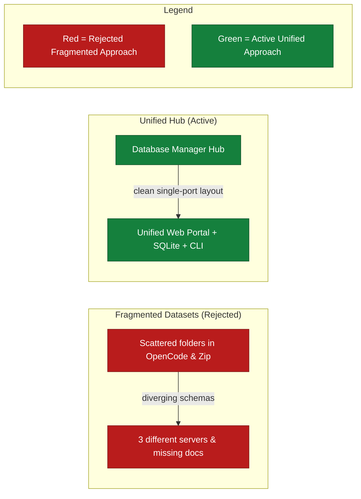

# Architectural Decisions, Pivots & Landmines (`DECISIONS_AND_TRAPS.md`)
> **1-Line Summary:** Records why we chose specific approaches, what failed when we tried other ways, who made the decision, and full explanations of critical code traps.

## 1. Architectural Decisions & Pivot History

### [DECISION: Unified-Multi-Domain-Manager] | Aliases: multi domain hub, repo merge, database manager
> **1-Line Summary:** Consolidated AI models, PC game compatibility, and hardware upgrade planning into a single `Database Manager` repository.
* **Decision Maker:** `[DECIDED BY: HUMAN]`
* **Original User Intention:** Eliminate fragmented datasets across `OpenCode\AI Rank`, `OpenCode\GameRank`, and `hardware-planner.zip` by uniting them under the Agentic Harness standard.
* **Options Considered:**
  * **Option A (Rejected):** Maintain 3 separate disconnected repositories, duplicating web servers, local CI scripts, and documentation suites.
  * **Option B (Chosen):** Create a unified `Database Manager` with modular domains (`data/ai/`, `data/games/`, `data/hardware/`), a unified tabbed Web Portal, and consolidated SQLite compilation.
* **Plain-English Summary of Pivot:** Maintaining 3 independent repos caused drift, duplicate servers, and inconsistent documentation. The unified hub provides one port (`8770`), one CLI, and one relational SQLite database.



### [DECISION: Zero-Dependency-Python-Backend] | Aliases: stdlib server, no pip, lightweight cli
> **1-Line Summary:** Built server and CLI using Python Standard Library (`http.server`, `sqlite3`, `json`) with zero pip dependencies.
* **Decision Maker:** `[DECIDED BY: AGENT - Approved by Human]`
* **Original User Intention:** Ensure the local server and CLI run instantly on any machine without installing heavy virtual environments or pip packages.
* **Options Considered:**
  * **Option A (Rejected):** Use FastAPI / Uvicorn or Express.js, requiring virtual environments, node_modules, and background dependency maintenance.
  * **Option B (Chosen):** Use built-in `http.server`, `socketserver`, and `sqlite3` from Python's standard library.
* **Plain-English Summary of Pivot:** Standard library execution starts in under 50ms, requires zero package installations, and eliminates environment breakages across updates.

### [DECISION: Multi-Tier-Scraper-Stack] | Aliases: scraper tiers, scrapling, httpx fallback, selectolax lexbor
> **1-Line Summary:** Tiered scraper framework (Tier 0 stdlib fallback -> Tier 1 httpx/selectolax -> Tier 2 scrapling stealth) with non-destructive diff previews.
* **Decision Maker:** `[DECIDED BY: HUMAN]`
* **Original User Intention:** Ingest live hardware prices and benchmark data reliably from hostile or bot-protected sites (Cloudflare, dynamic DOMs) without hard crash when optional dependencies are absent.
* **Options Considered:**
  * **Option A (Rejected):** Heavy Playwright/Selenium browser automation for everything, bloating CI and consuming 500MB+ disk and memory.
  * **Option B (Chosen):** Multi-tier fallback architecture: Tier 0 (`urllib.request` + regex) works with zero pip packages in CI; Tier 1 (`httpx` + `selectolax.lexbor`) provides 10x parsing speed; Tier 2 (`scrapling`) bypasses TLS fingerprinting for protected domains like Bikroy.
* **Plain-English Summary of Pivot:** Tiered fallback guarantees that offline local CI and GitHub Actions pass without installing external packages, while local developer machines with `requirements-scrapers.txt` can perform live fetches against protected retailers.

### [DECISION: Separated-Domain-SQLite-With-Federated-Hub] | Aliases: separated dbs, sqlite attach federation, data registry
> **1-Line Summary:** Split monolithic SQLite database into independent per-domain SQLite databases (`ai.sqlite`, `games.sqlite`, `hardware.sqlite`, `cpus.sqlite`) unified via in-memory ATTACH federation and `data/registry.json`.
* **Decision Maker:** `[DECIDED BY: HUMAN]`
* **Original User Intention:** Allow individual domains to be refreshed, validated, and extended independently without touching or locking unrelated datasets.
* **Options Considered:**
  * **Option A (Rejected):** Single monolithic `database.sqlite` where schema migrations in one domain risk corrupting unrelated domains.
  * **Option B (Chosen):** Domain-isolated databases with SHA-256 metadata tables, tracked in `registry.json`, federated on-demand via SQLite `ATTACH DATABASE` in `src/db_hub.py`.
* **Plain-English Summary of Pivot:** Each domain retains its own schema, TTL expiration, and export pipeline, while cross-domain views (`v_games_by_gpu`, `v_cpu_gpu_combos`) provide unified multi-domain querying.

---

## 2. Critical Engineering Traps & Landmines

### [TRAP: String-Suffix-Context-Window-Parsing] | Aliases: 1M context, 200k tokens, ValueError int
> **1-Line Summary:** Upstream AI model catalogs format context tokens with string suffixes (`'1M'`, `'200k'`), causing Python `int()` conversions to throw `ValueError`.
* **Where It Lurks:** `src/db_export.py` -> `parse_context_window`
* **What Goes Wrong:** Upstream API responses and manual markdown catalogs mix integer token counts (e.g., `128000`) with shorthand human representations (e.g., `'1M'` for Claude Opus or `'200k'`). Calling `int(ctx)` throws `ValueError: invalid literal for int() with base 10: '1M'`.
* **The Permanent Fix:** Always route token fields through `parse_context_window()`:
  ```python
  if s.endswith("M"): return int(float(s[:-1]) * 1_000_000)
  if s.endswith("K"): return int(float(s[:-1]) * 1_000)
  ```

### [TRAP: Selectolax-Lexbor-Deprecation-In-Python-3-13-Plus] | Aliases: modest backend deprecated, selectolax lexbor, HTMLParser import
> **1-Line Summary:** `selectolax 1.0+` deprecates the legacy Modest backend (`selectolax.parser.HTMLParser`) with a noisy `ImportError` / deprecation warning.
* **Where It Lurks:** `src/scrapers/adapters.py`, `src/scrapers/bd_hardware.py`
* **What Goes Wrong:** In newer selectolax versions on Python 3.12+, importing `from selectolax.parser import HTMLParser` raises warnings or fails.
* **The Permanent Fix:** Always use `from selectolax.lexbor import LexborHTMLParser as HTMLParser` with a graceful try-except fallback to the legacy parser.

### [TRAP: Star-Tech-Price-Span-Concatenation] | Aliases: star tech price, price-new price-old, 39005000 bdt
> **1-Line Summary:** Star Tech product cards contain both `.price-new` (discounted) and `.price-old` (regular) inside `.p-item-price`; taking raw `.text()` concatenates both numbers into an astronomical figure (e.g. ৳39,005,000).
* **Where It Lurks:** `src/scrapers/bd_hardware.py` -> `parse_star_tech_html`
* **What Goes Wrong:** A card with regular price ৳50,000 and sale price ৳39,000 renders `<span class="price-new">39,000৳</span><span class="price-old">50,000৳</span>`. Calling `card.css_first(".p-item-price").text()` extracts `"39,000৳50,000৳"`, stripping non-digits yields `3900050000` or `39005000`.
* **The Permanent Fix:** Target `.price-new` exclusively first. Only fall back to `.p-item-price` if no `.price-new` element exists. Validate extracted prices against sane GPU price bounds (e.g., `10,000 <= price <= 250,000`).

### [TRAP: SQLite-Dict-Parameter-Binding-Error] | Aliases: sqlite3 programmingerror type dict, binding parameter
> **1-Line Summary:** Passing Python dictionary objects directly as SQLite parameter bindings causes `sqlite3.ProgrammingError: Error binding parameter: type 'dict' is not supported`.
* **Where It Lurks:** `src/db_export.py` -> dynamic JSON ingestion
* **What Goes Wrong:** Nested JSON catalog structures (e.g., `pricing` or `specs`) passed into `cursor.execute("INSERT ... VALUES (?, ?)", (id, obj))` fail because SQLite only supports native scalars (int, float, str, bytes, None).
* **The Permanent Fix:** Explicitly serialize nested dicts/lists to JSON strings (`json.dumps(obj)`) or extract primitive scalar fields before binding.

### [TRAP: High-TDP-Transient-Power-Spikes] | Aliases: psu trip, 550w cx550, transient excursion
> **1-Line Summary:** High-TDP GPUs (>= 250W) produce 2.0x microsecond transient excursions that trip Over-Current Protection (OCP) on 550W power supplies.
* **Where It Lurks:** `data/hardware/hardware_specs.json` -> `transient_rules`, `web/hardware/index.html` -> `updateCalculator`
* **What Goes Wrong:** Users assume a 263W GPU (like the RX 7800 XT) fits within a 550W PSU because `263W + 85W = 348W continuous < 550W`. However, during scene transitions, GPUs draw microsecond transient bursts up to 2.0x TDP (526W). Combined with the 85W base platform, the 611W spike exceeds the 550W single-rail OCP ceiling, causing immediate system power cuts.
* **The Permanent Fix:** Never calculate PSU safety using TDP alone. Always apply transient multipliers: Low TDP (< 180W): 1.35x, Mid TDP (180-250W): 1.65x, High TDP (>= 250W): 2.0x. Flag any card where `peak_spike > psu_capacity` as `OCP Trip Risk`.

### [TRAP: Effort-Simulation-Key-Mismatch] | Aliases: nan scores, ultra vs ultra_high, coding elo nan
> **1-Line Summary:** Discrepancy between `update_models.ps1` (`ultra`) and `app.js` (`ultra_high`) caused effort simulation scores to calculate as `NaN` across all models.
* **Where It Lurks:** `web/ai/model_matrix/app.js` -> `normalizeEffortKey`
* **What Goes Wrong:** When simulating reasoning effort, `app.js` looked for `sim.multipliers.ultra_high`, while the data catalog only defined `ultra`. This produced `NaN` across ~130 cells in the matrix table.
* **The Permanent Fix:** `app.js` implements `normalizeEffortKey()` and fallback delta clamps, ensuring both `ultra` and `ultra_high` resolve identically.

### [TRAP: Binary-Redirection-Encoding-In-Powershell] | Aliases: powershell redirect, utf8 bom corrupt
> **1-Line Summary:** Using PowerShell `>` redirection on binary web downloads corrupts files with UTF-16/BOM encoding.
* **Where It Lurks:** `src/update_models.ps1` and PowerShell download scripts.
* **What Goes Wrong:** In Windows PowerShell 5.1, `curl.exe ... > file.bin` or `Invoke-WebRequest ... > file.bin` applies text encoding, corrupting binary archives and images.
* **The Permanent Fix:** Always use `Invoke-WebRequest -Uri ... -OutFile file.bin` or `[System.IO.File]::WriteAllBytes()`.
