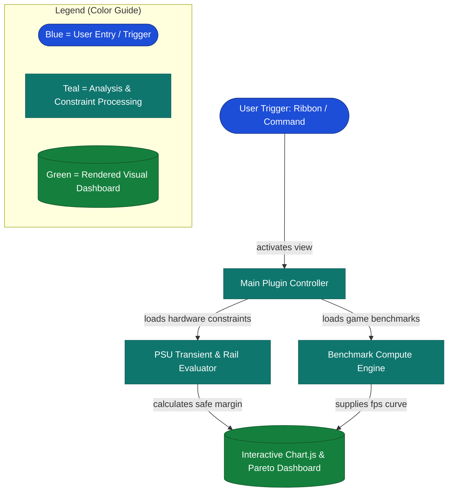
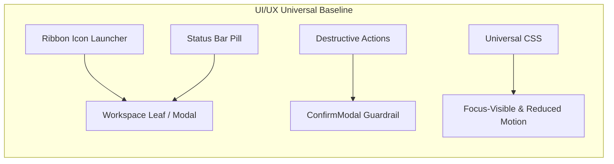

# System Architecture (`ARCHITECTURE.md`)
> **1-Line Summary:** Modular TypeScript Obsidian plugin architecture compiling via esbuild into a zero-dependency runtime bundle.

## 1. High-Level Visual System Map
* **Plain-English Overview:** The user opens the Hardware Planner view from Obsidian ribbon or palette. The view loads local benchmark data, applies user rig constraints (CPU/PSU), renders interactive Chart.js visualizations, and allows filtering by price and power limit.

## 2. Tech Stack & Why We Chose It

| Layer | Tool / Library | Plain-English Reason Why |
| --- | --- | --- |
| Host / UI | Obsidian Plugin API (`obsidian`) | Native desktop & mobile knowledge-base integration. |
| Language | TypeScript 5+ | Strict types for benchmark data, pricing calculations, and hardware specs. |
| Visuals | Chart.js | Hardware-accelerated canvas rendering for Pareto scatter plots. |
| Bundler | esbuild | Sub-second zero-config bundle into pure modular `main.js`. |

## 3. Core Subsystems & Engineering Tricks

### [SUBSYSTEM: Upgrade-Recommendation-Engine] | Aliases: recommendation algorithm, pareto frontier
> **1-Line Summary:** Computes the mathematical convex hull of FPS-per-BDT to identify dominant upgrade candidates.
* **How It Works (Plain English):** Filters out dominated GPUs (higher cost and lower FPS), leaving only Pareto-optimal options plotted on an interactive curve.
* **Code Anchors (Grep Targets):**
  * `src/main.ts` -> `computeParetoFrontier`

### [SUBSYSTEM: PSU-Safety-Calculator] | Aliases: transient margin calculator, rail wattage checker
> **1-Line Summary:** Evaluates continuous wattage plus 20ms transient power excursions against single-rail OCP limits.
* **Code Anchors (Grep Targets):**
  * `src/psu.ts` -> `evaluatePsuThresholds`

## 4. Recipes: How to Add New Things Safely
* **To add a new GPU benchmark profile:**
  1. Add model specs and power metrics in `src/psu.ts` -> `GPU_POWER_DATABASE`.
  2. Add benchmark scores in `src/main.ts` -> `BENCHMARK_PROFILES`.

### [SUBSYSTEM: UI-UX-Parity-And-Accessibility] | Aliases: status bar, ribbon icon, confirm modal, focus-visible, reduced-motion
> **1-Line Summary:** Integrates native Obsidian workspace UI touchpoints (ribbon launcher, live status bar pill, modal confirmation guardrails) and WCAG AA accessibility styles.
* **Architecture / Subsystem Role:** Standardizes the plugin surface across desktop and mobile Obsidian clients with keyboard accessibility, reduced-motion safety, and high-visibility status telemetry.
* **Component Diagram:**

* **Code Anchors (Grep Targets):** `src/main.ts`, `styles.css`
