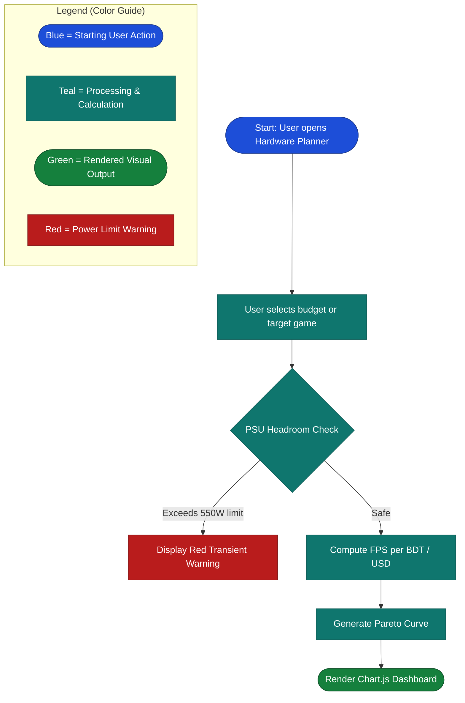

# Visual Feature & Change Log (`VISUAL_LOG.md`)
> **1-Line Summary:** Visual flowcharts explaining key user interaction flows in PC Hardware Planner.

## Feature & Change Flowcharts

### [VISUAL: Upgrade-Analysis-Flow] | Aliases: compare gpu workflow, benchmark calculation
> **1-Line Summary:** Complete flow from user hardware input to Pareto value chart rendering.

* **Plain-English Walkthrough:** The user opens the comparison modal, inputs budget or target game title. The engine looks up benchmark data, checks PSU margin, calculates Pareto efficiency, and draws the color-coded Chart.js scatter plot.

